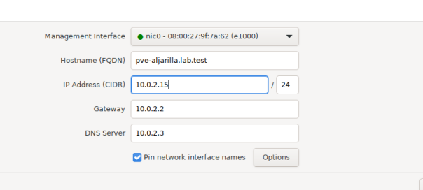
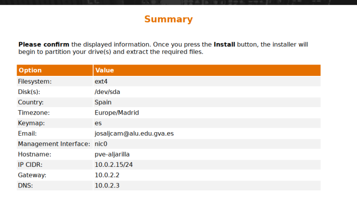
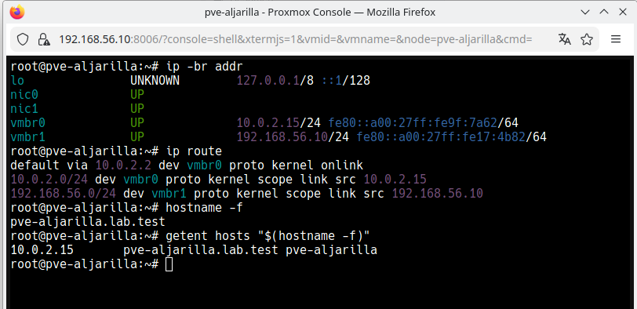

# 03 - Instalación de Proxmox VE

## Objetivo

Instalar y configurar Proxmox VE 9.2.2 en una máquina virtual de VirtualBox para crear un entorno de virtualización donde posteriormente se desplegarán dos máquinas Ubuntu Server sin entorno gráfico.

Se configurarán las interfaces de red, el acceso web, la virtualización anidada y el almacenamiento del nodo.

## Procedimiento

### 1. Preparación de VirtualBox

Se creó una máquina virtual para Proxmox con los siguientes recursos:

| Recurso | Configuración |
|---|---|
| Sistema operativo | Debian (64 bits) |
| Memoria RAM | 8 GB |
| Procesadores | 2 vCPU |
| Disco duro | 80 GB VDI dinámico |
| Adaptador 1 | NAT |
| Adaptador 2 | Solo-anfitrión |

Se configuró una red solo-anfitrión denominada `vboxnet0`, con dirección `192.168.56.1/24` y servidor DHCP desactivado.

### 2. Instalación de Proxmox

Se inició la máquina virtual utilizando la ISO de Proxmox VE y se realizó la instalación sobre el disco virtual.

Se configuraron los siguientes parámetros de red:

| Parámetro | Valor |
|---|---|
| Hostname | `pve-aljarilla.lab.test` |
| Dirección IP | `10.0.2.15/24` |
| Gateway | `10.0.2.2` |
| DNS | `10.0.2.3` |

Una vez finalizada la instalación, se reinició la máquina virtual y se accedió a la terminal de Proxmox con el usuario `root`.

### 3. Configuración de los puentes de red

Se comprobaron las interfaces disponibles mediante los comandos `ip -br link`, `ip -br addr` e `ip route`.

Posteriormente, se editó el archivo `/etc/network/interfaces` para configurar los puentes:

- **vmbr0:** conectado a `nic0`, permite la salida a Internet mediante NAT.
- **vmbr1:** conectado a `nic1`, permite la comunicación con el equipo anfitrión mediante la red solo-anfitrión.

Se asignó a `vmbr1` la dirección `192.168.56.10/24`.

Los cambios se aplicaron mediante `ifreload -a` y se comprobó que ambas interfaces estuvieran operativas.

### 4. Acceso a la interfaz web

Se accedió al panel de administración de Proxmox desde Firefox utilizando la dirección:

`https://192.168.56.10:8006`

Se inició sesión con el usuario `root` y el método de autenticación Linux PAM.

Se confirmó que el nodo `pve-aljarilla` aparecía en el panel de administración.

### 5. Comprobación de la virtualización anidada

Se ejecutó el comando correspondiente para comprobar que Proxmox reconocía las extensiones de virtualización del procesador.

El resultado obtenido fue `8`, indicando que el sistema detecta dichas extensiones.

Queda pendiente comprobar el funcionamiento real de KVM mediante el arranque de una máquina virtual dentro de Proxmox.

### 6. Comprobación de red y almacenamiento

Se verificaron las direcciones IP, la puerta de enlace, el hostname y la resolución de nombres.

También se comprobó el almacenamiento mediante `pvesm status` y `df -h`.

Se identificaron los siguientes almacenamientos:

- **local:** utilizado principalmente para imágenes ISO, plantillas y copias de seguridad.
- **local-lvm:** destinado al almacenamiento de los discos de las máquinas virtuales.

Finalmente, se revisó la distribución del disco y sus particiones desde la interfaz web.

## Comandos usados

**Comprobación de interfaces y rutas:**

```bash
ip -br link
ip -br addr
ip route
```

**Edición y aplicación de la configuración de red:**

```bash
nano /etc/network/interfaces
ifreload -a
```

**Comprobación del hostname:**

```bash
hostname -f
getent hosts "$(hostname -f)"
```

**Comprobación de virtualización anidada:**

```bash
grep -Ec '(vmx|svm)' /proc/cpuinfo
```

**Comprobación del almacenamiento:**

```bash
pvesm status
df -h
```

## Evidencias

Las capturas se encuentran en `evidencias/capturas-o-salidas/s03-instalacion-proxmox/`.

### Configuración de red del instalador



### Resumen de instalación



### Comprobación inicial de red


### Configuración de puentes virtuales


### Acceso web a Proxmox


### Virtualización anidada


### Validación final de red



### Comprobación del almacenamiento


### Distribución del disco


## Incidencias

Durante la práctica se detectaron las siguientes cuestiones:

- Se produjeron errores de escritura al ejecutar inicialmente el comando `getent hosts`, que se corrigieron.
- Se observó un error durante una tarea de actualización de paquetes, pendiente de revisión.
- La resolución del hostname devolvió la IP `10.0.2.15`; queda pendiente ajustarla a la IP de gestión `192.168.56.10`, según la guía.

Estas incidencias no impidieron acceder al panel web ni verificar las interfaces y el almacenamiento.

## Conclusion

Se completó la instalación de Proxmox VE dentro de VirtualBox y se configuraron los puentes de red para permitir el acceso al nodo desde el equipo anfitrión.

También se verificó la detección de virtualización anidada y la disponibilidad de los almacenamientos `local` y `local-lvm`.

El entorno está preparado para continuar con las comprobaciones pendientes y la creación de las máquinas Ubuntu Server.
