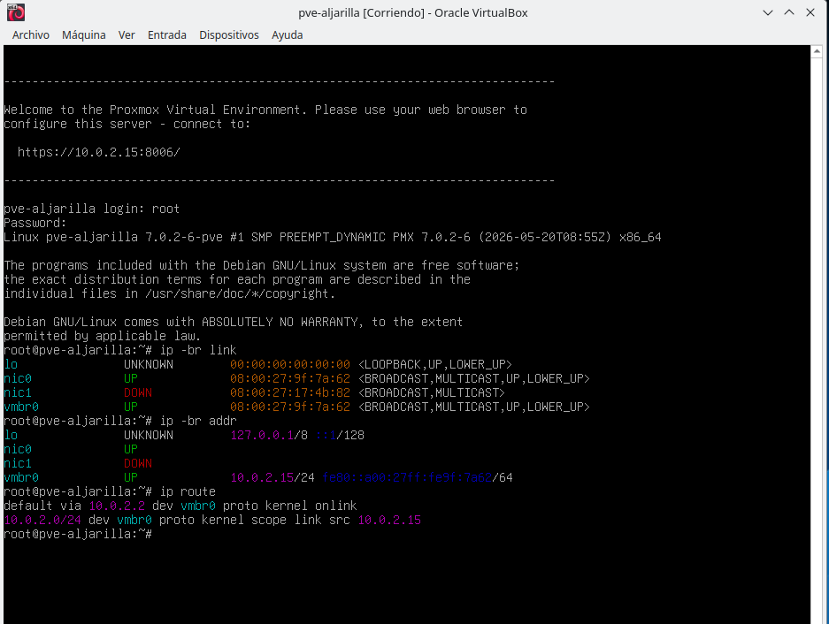
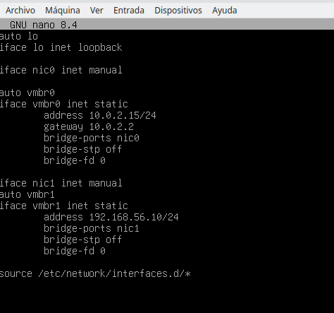
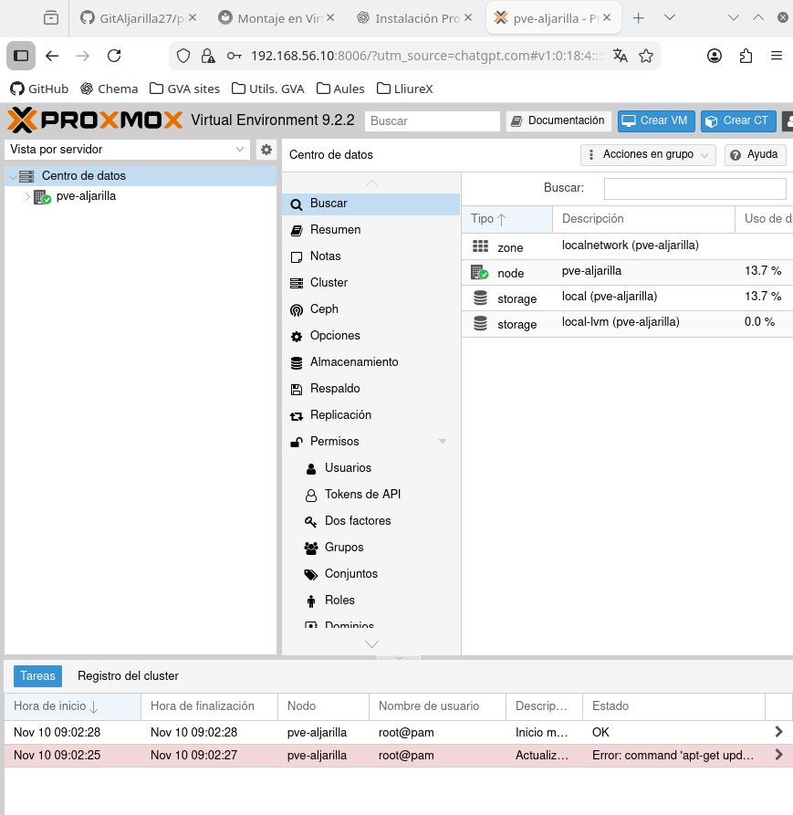
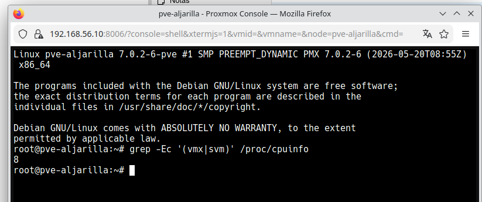
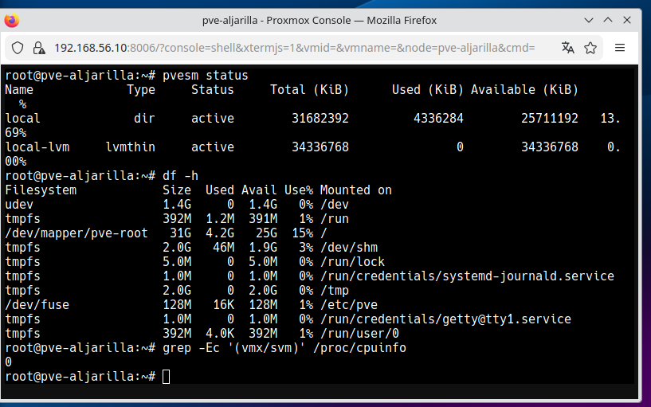
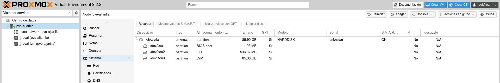

# 03 - Instalación de Proxmox VE

## Objetivo

Se instala y configura Proxmox VE 9.2.2 dentro de una máquina virtual de VirtualBox para crear un entorno de virtualización destinado al despliegue de un servidor Ubuntu y un cliente Linux.

Se configuran las interfaces de red, el acceso web, la virtualización anidada y el almacenamiento del nodo.

También se realizan comprobaciones para verificar que Proxmox puede ejecutar máquinas virtuales mediante KVM/QEMU.

## Procedimiento

### 1. Preparación de VirtualBox

Se crea una máquina virtual para Proxmox con los siguientes recursos:

| Recurso | Configuración |
|---|---|
| Sistema operativo | Debian (64 bits) |
| Memoria RAM | 3,82 GiB disponibles en Proxmox |
| Procesadores | 4 vCPU |
| Disco duro | Aproximadamente 62 GB de capacidad virtual |
| Adaptador 1 | NAT |
| Adaptador 2 | Solo-anfitrión |

Se configura una red solo-anfitrión denominada `vboxnet0`, con dirección `192.168.56.1/24` y servidor DHCP desactivado.

Esta configuración permite separar la conectividad externa de la red interna utilizada para administrar Proxmox y conectar las máquinas virtuales.

Los valores de CPU, RAM y almacenamiento corresponden a los recursos comprobados posteriormente desde el nodo Proxmox.

### 2. Instalación de Proxmox

Se inicia la máquina virtual utilizando la ISO de Proxmox VE y se realiza la instalación sobre el disco virtual.

Durante la instalación se configuran inicialmente los siguientes parámetros de red:

| Parámetro | Valor |
|---|---|
| Hostname | `pve-aljarilla.lab.test` |
| Dirección IP | `10.0.2.15/24` |
| Gateway | `10.0.2.2` |
| DNS | `10.0.2.3` |

Una vez finalizada la instalación, se reinicia la máquina virtual y se accede a la terminal de Proxmox mediante el usuario `root`.

Posteriormente, se adapta la configuración de red para permitir la administración del nodo a través de la red solo-anfitrión.

### 3. Configuración de los puentes de red

Se comprueban las interfaces disponibles mediante los siguientes comandos:

```bash
ip -br link
ip -br addr
ip route
```

Se edita el archivo `/etc/network/interfaces` para configurar dos puentes de red:

- **vmbr0:** conectado a `nic0`, utiliza la red NAT de VirtualBox y permite la conectividad externa del nodo.
- **vmbr1:** conectado a `nic1`, utiliza la red solo-anfitrión y permite la comunicación con el equipo anfitrión y las máquinas virtuales del laboratorio.

Se establece la siguiente configuración:

| Interfaz | Dirección IP | Función |
|---|---|---|
| vmbr0 | 10.0.2.15/24 | Conectividad NAT |
| vmbr1 | 192.168.56.10/24 | Gestión y red interna |

La puerta de enlace predeterminada del nodo es `10.0.2.2`, asociada a `vmbr0`.

Los cambios se aplican mediante:

```bash
ifreload -a
```

Se comprueba que ambas interfaces están operativas y que las rutas de red son correctas.

### 4. Acceso a la interfaz web

Se accede al panel de administración de Proxmox desde Firefox utilizando la dirección:

`https://192.168.56.10:8006`

Se inicia sesión mediante el usuario `root@pam`, utilizando el sistema de autenticación Linux PAM.

Se confirma que el nodo `pve-aljarilla` aparece correctamente en la interfaz web.

De esta forma, se verifica que la administración de Proxmox funciona desde el ordenador anfitrión mediante la red solo-anfitrión.

### 5. Comprobación de la virtualización anidada

Se comprueba que Proxmox detecta las extensiones de virtualización del procesador mediante el comando:

```bash
grep -Ec '(vmx|svm)' /proc/cpuinfo
```

El resultado obtenido es `8`, lo que confirma que se detectan las extensiones de virtualización dentro de la máquina virtual de Proxmox.

Posteriormente, se crea la máquina virtual `100 (srv-aso)` y se consigue arrancar Ubuntu Server utilizando KVM/QEMU.

De esta forma, se comprueba tanto la detección de las extensiones del procesador como el funcionamiento práctico de la virtualización anidada.

### 6. Comprobación de red y almacenamiento

Se verifican las direcciones IP, la puerta de enlace, el hostname y la resolución de nombres.

Se corrige la resolución del hostname para que `pve-aljarilla.lab.test` corresponda a la dirección de gestión `192.168.56.10`.

La comprobación se realiza mediante:

```bash
hostname -f
getent hosts "$(hostname -f)"
```

También se comprueba el almacenamiento mediante:

```bash
pvesm status
df -h
```

Se identifican los siguientes almacenamientos:

- **local:** utilizado principalmente para imágenes ISO, plantillas y copias de seguridad.
- **local-lvm:** destinado al almacenamiento de discos de máquinas virtuales.

Se verifica que ambos almacenamientos se encuentran activos y disponen de espacio libre.

Finalmente, se revisa la distribución del disco y sus particiones desde la interfaz web.

### 7. Creación y arranque de una máquina virtual de prueba

Para comprobar el funcionamiento de la virtualización anidada, se utiliza la máquina virtual `100 (srv-aso)`.

Se configura con los siguientes recursos:

| Recurso | Configuración |
|---|---|
| VM ID | 100 |
| Nombre | srv-aso |
| Procesadores | 1 vCPU |
| Memoria RAM | 2048 MiB |
| Disco duro | 20 GB |
| Almacenamiento | local-lvm |
| Adaptador de red | VirtIO |
| Puente de red | vmbr1 |
| Sistema operativo | Ubuntu Server 26.04.1 |

Se monta la imagen ISO de Ubuntu Server y se inicia el instalador.

Inicialmente, se había instalado una versión minimizada del sistema. Posteriormente, se decide reinstalar Ubuntu Server utilizando la opción de instalación estándar para disponer de un entorno más completo.

Se realiza la instalación con el hostname `srv-aso` y el usuario `jose`.

Tras finalizar la instalación, se retira el medio de instalación virtual para permitir el arranque desde el disco del sistema.

El arranque de Ubuntu Server dentro de Proxmox permite comprobar el funcionamiento de KVM/QEMU.

La configuración IPv4 definitiva y las pruebas de conectividad de esta máquina quedan pendientes para las siguientes fases del proyecto.

## Comandos usados

### Comprobación de interfaces y rutas

```bash
ip -br link
ip -br addr
ip route
```

### Edición y aplicación de la configuración de red

```bash
nano /etc/network/interfaces
ifreload -a
```

### Comprobación del hostname

```bash
hostname -f
getent hosts "$(hostname -f)"
```

### Comprobación de virtualización anidada

```bash
grep -Ec '(vmx|svm)' /proc/cpuinfo
```

### Comprobación del almacenamiento

```bash
pvesm status
df -h
```

### Comprobaciones adicionales del sistema

```bash
hostnamectl
pveversion
```

Estos últimos comandos se incluyen para documentar la identificación del sistema y la versión de Proxmox. Sus salidas deberán incorporarse a las evidencias si todavía no están recogidas.

## Evidencias

Las capturas originales se encuentran en:

`evidencias/capturas-o-salidas/s03-instalacion-proxmox/`

### Configuración de red del instalador


### Resumen de instalación


### Comprobación inicial de red



### Configuración de puentes virtuales



### Acceso web a Proxmox



### Virtualización anidada



### Validación final de red


### Comprobación del almacenamiento



### Distribución del disco



### Evidencias complementarias pendientes de incorporar

Se deben revisar e incorporar, si todavía no se encuentran en el repositorio, las siguientes evidencias:

- Arranque correcto de una máquina virtual mediante KVM/QEMU.
- Instalación estándar y funcionamiento de Ubuntu Server.
- Salida del comando `hostnamectl`.
- Salida del comando `pveversion`.

No es necesario repetir las pruebas que ya se hayan realizado y capturado anteriormente.

## Incidencias

Durante el desarrollo de la práctica se identifican las siguientes incidencias:

### 1. Errores al comprobar la resolución del hostname

Inicialmente, se producen errores de escritura al ejecutar el comando `getent hosts`.

Se corrige la sintaxis y se consigue ejecutar correctamente.

### 2. Resolución incorrecta del hostname

Se detecta que el hostname del nodo se resuelve inicialmente mediante la dirección `10.0.2.15`, correspondiente a la red NAT.

Se modifica la configuración de resolución local para asociar `pve-aljarilla.lab.test` con la dirección de gestión `192.168.56.10`.

Se comprueba posteriormente que la resolución funciona correctamente.

**Estado: resuelta.**

### 3. Error durante una actualización de paquetes

Se observa un error durante una tarea de actualización de paquetes.

Esta incidencia no impide acceder al panel de administración ni utilizar las funciones principales de Proxmox.

**Estado: pendiente de revisión.**

### 4. Instalación minimizada de Ubuntu Server

Inicialmente, se instala Ubuntu Server mediante la opción minimizada.

Se comprueba que esta instalación no resulta adecuada para las necesidades previstas de la práctica, por lo que se decide reinstalar el sistema con la opción estándar.

Se reutiliza la máquina virtual `100 (srv-aso)` y se realiza la nueva instalación.

**Estado: reinstalación estándar realizada; comprobaciones posteriores pendientes.**

## Conclusión

Se completa la instalación de Proxmox VE 9.2.2 dentro de VirtualBox y se configuran los puentes de red necesarios para su administración y conectividad.

Se verifica el acceso a la interfaz web mediante `192.168.56.10:8006`, la resolución del hostname y la disponibilidad de los almacenamientos `local` y `local-lvm`.

También se comprueba el funcionamiento de la virtualización anidada mediante la ejecución de Ubuntu Server dentro de una máquina virtual gestionada por Proxmox.

La infraestructura principal queda instalada y operativa.

Queda pendiente completar algunas evidencias complementarias, revisar la incidencia relacionada con la actualización de paquetes y continuar con la configuración de las máquinas virtuales en las siguientes fases.

[Volver al índice](../README.md)

